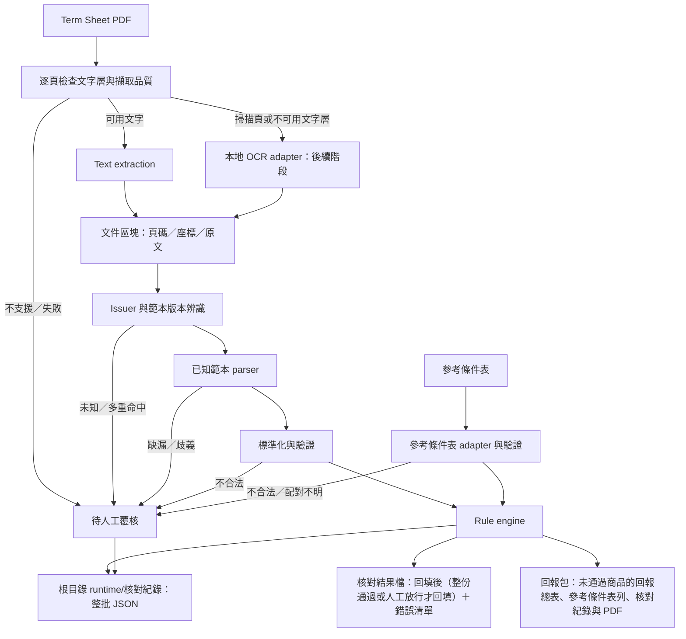

# 架構概覽

## 目標與範圍

協助作業人員將 FCN Term Sheet 與已確認的下單資料逐欄比對，輸出可回溯到原文件的例外清單。第一階段先支援一家 issuer 的一個文字型 PDF 範本；不做產品定價、交易執行、法律條款解釋或無人覆核的交易放行。

已實作 BARC／HSBC／MS 文字型 PDF 的核對（Issue #7、#9、#41、#34、#135、#137）、BNP 說明書與投資人須知的核對（Issue #191、#197）、SG 說明書與投資人須知的核對（Issue #194、#213）、Citi 說明書與投資人須知的核對（Issue #220）、JPM 說明書與投資人須知的核對（Issue #233）、Nomura 說明書與投資人須知的核對（Issue #239）、GS 說明書與投資人須知的核對（Issue #248）、Natixis 說明書與投資人須知的核對（Issue #261）、CA 說明書與投資人須知的核對（Issue #274）、BBVA 說明書與投資人須知的核對（Issue #269）、DBS 說明書與投資人須知的核對（Issue #280）與 UBS 說明書與投資人須知的核對（Issue #279），以參考條件表批量核對多份說明書並回填 ISIN 與比價日（Issue #43、#46，[ADR 0008](adr/0008-reference-sheet-and-import-format.md)）；說明書與同商品投資人須知成對核對，兩份都通過或放行才回填（Issue #124，[ADR 0007](adr/0007-iis-paired-with-term-sheet.md)）；OCR 與更多範本仍為目標設計。名詞見 [CONTEXT.md](../CONTEXT.md)。

## 系統資料流

OCR 尚未實作時，掃描頁直接回報不支援並要求覆核。混合型 PDF 逐頁處理，不因某頁有文字就跳過其他頁。LLM 不在第一版執行路徑內。

## 建議模組邊界

第一階段實際模組如下（OCR adapter 尚未建立）。

| 預定路徑 | 職責 | 邊界 |
|---|---|---|
| `src/fcn_checker/ingestion.py` | 文件 hash、加密／破損檢查；輸入錯誤轉 ERROR 結果；來源快照 `SourceSnapshot`（參考條件表、各份說明書與設定檔的路徑和 hash，各在讀取前取一次：設定檔在載入核對設定前、參考條件表與說明書在預覽前；核對紀錄的檔案資訊取自它，`still_valid` 明確重算比對）；輸出檔一律新建 `write_new`（已存在不覆蓋、無法寫入分開回報） | 不解析金融欄位；不嘗試繞過密碼 |
| `src/fcn_checker/extraction.py` | PyMuPDF 逐頁文字行、頁碼、bbox 與每個字的 x 範圍（`Line.char_spans`，Issue #264）；排除頁碼雜訊 | 輸出頁碼、座標、文字；不判斷核對結果 |
| `src/fcn_checker/issuers.py` | 上手註冊表：每家上手只提供識別資料（代號、範本、名稱、parser 版本、未涵蓋清單）、辨識 `detect`、讀出 `read`（標準欄位＋上手專屬資料）、說明書內部規則 `rules`、規則可讀的參考條件表欄位 `reference_fields`（[ADR 0009](adr/0009-shared-rules-defined-per-rule.md)：BARC 宣告年利率與天期、MS、BNP、SG、Citi、JPM 宣告年利率），以及投資人須知範本 `iis`（`IisTemplate`：識別資料、`detect`、`read`、未涵蓋清單、範本專屬規則 `rules`（選填，MS 有）；沒有的上手其投資人須知為未支援上手，ADR 0007）；`detect_iis` 辨識投資人須知範本；範本辨識 `detect` 零個或多個命中轉人工覆核 | 批量入口、CLI、PANEL 都由此分派；新增上手在此登記，並在 `config/issuer_prefixes.toml` 登記上手編號與不支援樣態 |
| `src/fcn_checker/parsers/` | `layout.py` 章／條／子項定位（格式由各上手的 `LayoutSpec` 提供）、跨行文字索引 `TextIndex`（可選括號統一全形；`separate_digits` 在相鄰數字行之間插 `|`，表格一格一行與算式換行時數字不相黏，各上手情境共用）與各上手兩種文件共用的欄位擷取 `capture`（`src/` 只此一份；證據預設只引值所在的行，說明書 parser 以 `whole_match` 連標籤的行一起引）、標的表彭博代碼換成兩行（`AVGO` / `UW`）時接回一行的 `join_wrapped_tickers`（CA、DBS、UBS 獨立的代碼表；Issue #231）；`price_table.py` 價格表讀取（上手以 `TableSpec` 宣告表名、表頭關鍵字、表頭百分比寫法（可宣告某欄可不寫 %）、列錨點（列號 `1`／`k=1`、彭博代碼、價格）、代碼欄與其他文字欄；表頭依同欄上下相接的行分格、欄序依表頭 x 位置，列依同頁最近的列錨點，表頭與最後一列只接到緊接的下一頁，彭博代碼（含代號中間換行）與價格的換行接回、擠成一行的格依字座標切開；交出 `PriceTable` 與共用的 `price_rows`；13 家格狀價格表（BNP 轉置表除外）都經這裡讀；Issue #287、#288）；`barc.py` 範本辨識與欄位、價格表宣告 `PRICE_TABLE`（`price_table.py`，以價格切列；§16 各情境表欄頭 % 另讀）；`barc_schedule.py` §13 配息表與提前出場表（轉成日期表 `schedule_table`）；`schedule.py` 提前出場排程的共用推導（上手交出 KO 觀察方式、k、比價日所在欄、末期比價日取表的末列或最終評價日；D 型只放第 k 期與末期；Issue #289）；`hsbc.py`／`hsbc_tables.py` HSBC 專屬欄位與表格（價格表以 `price_table.py` 讀、以彭博代碼切列，中文名稱／幣別／交易所是文字欄；`hsbc_tables.py` 只剩配息表與定期 KO 表）；`ms.py`／`ms_tables.py`／`ms_scenario.py` MS 範本辨識（新版）、封面項目與各條欄位、日期表／價格表（`price_table.py`，以彭博代碼切列；標題列出的欄須與表頭一致）／標的表／費用表、第 18 項情境；`bnp.py`／`bnp_tables.py`／`bnp_scenario.py` BNP 範本辨識、封面項目（項號獨立一行）與各條欄位、標的表（以列標籤切段、在去空白全文上讀值）／日期表（D／P 表頭、「不適用」列）／費用表、第 18 項(3) 情境（含標的幣別 ≠ 商品幣別的匯率寫法）；`sg.py`／`sg_tables.py`／`sg_scenario.py` SG 範本辨識（兩種版面；頁尾註腳不算內文）、封面兩欄表與各條欄位（第 8 項集中配息率、KO 觀察、記憶事件、KI 款數、下限價／執行價）、價格表（`price_table.py`，以執行價欄的價格切列，列數須等於第 9 項(1) 的代碼數）／日期表（D 三欄、P 兩欄、「不適用」列、末列標籤）／費用表、第 15 項(3) 情境（含 quanto 匯率）；`citi.py` Citi 範本辨識（頁尾「第N頁，共M頁」不算內文）、封面 `‧` 兩欄表與各條欄位（第 8 項 KI、第 12 項日期與 (9) D 型 Non-Call、第 13 項配息率與 KO %、記憶式）、價格表與第 15 項假設價格表（`price_table.py`，以左欄列號切列；期初定價讀期初股價欄的表頭）／日期表（D 三欄、P 兩欄、只有配息日）／費用表（新文件分銷費用取「費用」子列）；`jpm.py` JPM 範本辨識（羅馬數字章名「I. 商品基本資料」；頁碼「N/M」不算內文）、封面兩欄表與各條欄位（第 8 項 KO 評價日寫法（D 型起始欄名與 k、P 型 k）、記憶式句型、觸碰價（KI）、年利率）、標的表與第 15 項假設價格表（`price_table.py`：第 9 項價格表以彭博代碼為列錨點，假設價格表以價格切列）／日期表（D 4 欄、D 3 欄、P 2 欄；表頭註腳上標數字略過）／費用表；`nomura.py` Nomura 範本辨識（頁首「N/M」不算內文）、封面「◎ 標籤：值」與各條欄位（名稱、地址等保留空白的值在原文合併文字 `RawText` 上讀）、第 7 項 KO／記憶式／KI 句型、價格表（`price_table.py`，以左邊界列號切列，K／KO／KI % 在表頭）／日期表（D／P、KO 價欄、KI 每期觀察的下限觸發決定日表）／費用表（依座標取費率欄）、第 14 項設定參數與百分比表；`gs.py` GS 範本辨識（沒有獨立封面：第 1 頁編號項目 1.～13.；頁底「第- N -頁，共M頁」與右上角重複章名不算內文）、第一章各條欄位、第 13 項觀察時程表、第 15 項連結標的價格表（`price_table.py`，以左欄列號為列錨點）與 KI／期初定價句型、第 16 項 KO 起始期與記憶式、第 17 項情境、費用表（一列費率欄剛好一個 X%~Y%）；`natixis.py` Natixis 範本辨識（`第一章、` 章名；頁底英文名稱、頁碼、分類標記不算內文）、封面「標籤：值」與各條欄位、連結標的價格表與情境價格表（`price_table.py`：前者以列號、後者以價格切列）、日期表、費用表；第一章條號中途重新從 1 編起時由 `NatixisDocument`（`Document` 子類別）依先後讀成第 1～26 條（Issue #270）；`bbva.py` BBVA 範本辨識（`一、` 章名六章；`ca.py` CA 範本辨識（沒有獨立封面：第 1–2 頁「● 標籤：值」；頁底「第N 頁，共M頁」不算內文；CJK 相容字先轉標準字）、第 9 項配息表（D／P）、KO 觀察與記憶式兩句、界限事件、價格表（`price_table.py`，以價格切列，K／KI／KO % 只在表頭；代碼依列序對到第 10 項）、第 15、16 項、費用表；`dbs.py` DBS 範本辨識（沒有章號：段落標題整行比對、商品基本資料兩欄表；頁底「N / M頁」不算內文；列項符號「‧」統一成「•」）、表A、最大利率值與第 1～k 期、KO 每日記憶式與下限觸發事件、表1 與情境價格表（`price_table.py`，以彭博代碼切列；表頭可能跨頁）、費用表（分銷費用子列佔費率欄時改讀右邊一欄）；`ubs.py` UBS 範本辨識（沒有封面與章號：段名單獨一行、段內項號「一、」重新起算，`UbsDocument`；頁底「第N頁，共M頁」與私用區字元 U+F020 不算內文；舊版「股權結構型債券」辨識失敗）、商品基本資料八配息表（D：配息觀察期間表、P：配息觀察日表）、提前出場觀察日（八與十二須一致）、記憶式（鎖定股票）、觸及下限事件、價格表（`price_table.py`，以價格切列，K／KI／KO % 在表頭；名稱依第九項標的表對到代碼）、十二日期、十五情境設定參數、一般交易事項；`common.py` 各上手說明書 parser 共用的小工具（保留空白的原文合併文字 `RawText`、同一句另一組的 `capture_group`（Nomura、GS）、數字 `dec`／`number`、推得欄位 `derived`、文件上一組值與原文行 `Hit`（多個值時用具名的 `NamedTuple`，規則以欄位名稱取值）與 `hits`／`one`、月配息率出處 `Mention`、情境標題 `SCENARIO_HEAD`、說明書沒有 KO 價（Non-Call = 天期）時的 KO 100% `NO_AUTOCALL_KO_PCT` 與補 KO 價 `ko_at_initial`（SG、MS；Issue #202）；Issue #196）；`money.py` 各上手說明書與投資人須知共用的金額旁幣別字擷取（認得的幣別寫法清單、股價與含「股」的實物交割算式不算（關鍵字在同一行或同一句的上一行都認得，算式結果仍算）、匯率不算；Issue #170、#179），以及說明文字裡的幣別字 `currency_words`（例：`以美元為計價單位`，每處一筆；BBVA、Nomura，Issue #305、#316）；`ms_wording.py` MS 說明書與投資人須知共用的條款句型表（KI 定義句、KO 觀察寫法、記憶式判斷、無 KI 句；MS 改版只改這裡，兩份 parser 各自決定判斷的段落與讀不到時的說明）；`iis.py` 投資人須知讀出結果 `IisSheet`（`f(name)`、全文索引、`provides` 宣告這份範本有的欄位）與共用擷取工具；`barc_iis.py`、`hsbc_iis.py`、`ms_iis.py`、`bnp_iis.py`、`sg_iis.py`、`citi_iis.py`、`jpm_iis.py`、`nomura_iis.py`、`gs_iis.py`、`natixis_iis.py`、`bbva_iis.py`、`ca_iis.py`、`dbs_iis.py`、`ubs_iis.py` 各上手投資人須知的辨識與讀出（BARC 價格表沿用 `barc.PRICE_TABLE`；MS 只支援新版，提前出場與觸及下限寫法只在「贖回價金之計算」段內判斷，句型取自 `ms_wording.py`；BNP 標的表、記憶式與 KI 句型沿用 `bnp.py`／`bnp_tables.py`，費用表依列首切段；SG 記憶式與 KI 句型沿用 `sg.py` 的 `ko_memory`、`ki_type`，價格表以 `price_table.py` 依彭博代碼切列；Citi 頁首「第N頁，共4頁」不算內文，KI 句型沿用 `citi.py` 的 `ki_type`，記憶式只看商品年期句與到期給付金額句；JPM、Nomura 頁碼「N/4」用 `iis.page_totals` 的 `PAGE_SLASH` 讀法，JPM KO／記憶式／KI 句型與價格表宣告沿用 `jpm.py`；Nomura 收益分配事項的標籤「」移開後沿用 `nomura.py` 的記憶式與 KI 句型，費用表沿用 `nomura.fee_rates`；GS 讀之前先把 CJK 相容字（U+F900–U+FAFF）轉成標準字，頁底「第- N -頁，共4頁」另行讀出總頁數，價格表宣告沿用 `gs.PRICE_TABLE`，KI 句型與費用表沿用 `gs.py`） | 使用錨點、座標與有限 regex；多重命中轉歧義，不任選 |
| `src/fcn_checker/schema.py` | 標準化型別：`ParsedField`、`Evidence`、`CheckResult`（必帶項目 `Item`：中文名稱與預期值出處 `ItemSource`，參考條件表出處另記 Excel 欄名；`document` 記這條結果屬於哪份文件）、文件種類 `DocKind`（說明書／投資人須知）、`CheckReport` | 缺值／歧義／不合法／不適用分開；保留來源證據；不依賴其他模組 |
| `src/fcn_checker/investor_sheet.py` | 投資人須知讀出結果 `IisSheet`（`f(name)`、全文索引、`provides` 宣告這份範本有的欄位）、投資人須知才有的欄位清單 `IIS_FIELDS`、共用規則讀欄位的 `read_iis` | 上手投資人須知 parser 與共用規則之間的 seam（ADR 0007）；範本沒有的欄位不核對，有但讀不到的轉人工覆核 |
| `src/fcn_checker/standard_fields.py` | 說明書標準欄位清單（`STANDARD_FIELDS`）、讀出結果介面 `TermSheet` 與值的形狀（`PriceRow`、`AutocallSchedule`、出處清單的一處 `Occurrence`（欄位、出處代號、位置、值；項目名稱由出處代號查共用表 `OCCURRENCE_NAMES`，Issue #294）、情境裡一處金額旁的幣別 `Money`；情境分析共用規則的 `TableAt`（價格表的位置與讀出的表）、`ScenarioParam`（情境假設值的一處，名稱查 `OCCURRENCE_NAMES`、正式值查 `SCENARIO_TARGETS`）、`ScenarioPrice`（較差情境寫出的一個價格），Issue #294） | 上手 parser 與共用規則之間的 seam：各上手 parser 依此交出欄位（含審查標準規則用的欄位），共用規則只經 `read_standard` 讀這些欄位；`TermSheet.f` 不丟例外，沒交出的欄位為 `not_provided` 缺漏；範本沒有的欄位由 adapter 交出 `absent`（不適用），共用規則不核對、不報缺漏 |
| `src/fcn_checker/config.py` | 解析審查標準、參考條件表格式、上手編號對照、交易所假日表（TOML，讀檔共用 `load_toml`；上手支援樣態表由 `variants.py` 以它讀同一個上手編號對照檔；交易所假日表 `load_exchange_holidays`，Issue #208）；缺檔或格式錯誤丟出 `IngestionError`（`config_not_found`／`config_invalid`）；審查通過日期為歷次清單，`ReviewStandard.approval_date_on` 依交易日選當天或之前最近一次 | 會隨時間改變的基準只在設定檔 |
| `src/fcn_checker/approval_dates.py` | 維護審查標準的審查通過日期清單（Issue #120）：只能新增晚於最新一筆的日期、修改／刪除最新一筆；寫回時只替換 `approval_dates`、`version`、`effective_date` 三行，先以暫存檔載入驗證再取代原檔 | 只由 PANEL 工作階段呼叫；檔案寫法和預期不同時拒絕自動修改 |
| `src/fcn_checker/trading_calendar.py` | 交易所假日表 `TradingCalendar`（Issue #208）：各市場的彭博交易所碼、全天休市日與涵蓋範圍（`config/exchange_holidays.toml`，由 `config.load_exchange_holidays` 載入）；`next_trading_day(日期, 彭博代號們)` 推算下一個一籃子預定交易日（跳過週末與所有標的市場的休市日），標的市場不在表上、讀不到標的或超出涵蓋範圍時另附不確定的原因；`closed` 判斷週末與已知市場休市日 | 不讀說明書；日期表期始日（`rules/schedule.py`，上手宣告 `next_trading_day` 時）經 `rules/kit.period_start` 使用（`IssuerContext.calendar`） |
| `src/fcn_checker/check_config.py` | 核對設定 `CheckConfig`：一次載入審查標準、參考條件表格式、上手編號對照、上手支援樣態表（`unsupported_variants`，與上手編號對照同一個檔，Issue #207）、交易所假日表（`exchange_calendar`，Issue #208）與上手註冊表，連同設定檔的路徑、載入前取的 hash（`files`）與版本（`record()` 給核對紀錄）；`with_registry` 換上手註冊表（測試放假上手）。設定檔預設位置（`CONFIG_DIR`、`DEFAULTS`）只在這裡定義；`ConfigPaths.load` 載入，`ConfigPaths.with_fallback` 為 PANEL 的規則（指定的設定資料夾缺參考條件表格式／上手編號對照／交易所假日表時改用程式內建設定） | CLI 依參數載入一次、PANEL 每次載入預覽時載入一次，之後只傳這一個值；設定檔有問題在載入時回報 |
| `src/fcn_checker/orders/reference.py` | 參考條件表 adapter（多列表格，所有上手共用）：一列只有一種型別 `OrderRecord`（標準欄位 → 值、Excel 欄名與儲存格位置一處完成；`get`／`underlying(i)`／`price(i, col)`／`autocall_date(n)`／`header`／`cell` 等讀法；標準欄位名怎麼組只在這裡；`OrderRecord.offline` 不經 Excel 直接以 dict 建列，測試用；`locate` 找第一張工作表裡有 `TDCC Code` 的表頭列，讀檔與輸出共用） | 只檢查必要欄：缺少或重複 → 整批錯誤，其他欄略過；禁止用文件值填補預期值 |
| `src/fcn_checker/rules/` | 版本化規則（rule_id）與明確容差；`kit.py` 為規則共用工具（`Context`／`IssuerContext`；被核對的是哪份文件只在 `Context.document` 講一次，投資人須知另帶頁數、檔名前 12 碼與同商品說明書，規則提到被核對的文件時用它的稱呼；核對結果 builder `Check`（規則、欄位、項目、所屬文件一次宣告；`needs` 掛依賴的說明書欄位，第一個有問題的自動轉人工覆核，`compare`／`result` 建結果，證據預設是依賴欄位的證據；三家上手不再各寫 check helper；上手說明書內部規則共用的 `first_bad`、`doc_check`、`structure_check`、算式驗算結果 `calc_result`、證據 `evidence`、參考條件表年利率 `annual_rate`、各出處月配息率比對 `rate_mentions` 也在這裡，Issue #196）、讀參考條件表的值與轉型 `order_value`（參考條件表的值有問題時項目自動是該欄）、`read_standard`）；各規則在建立結果的地方寫項目名稱，兩家上手共用的名稱（價格 `UL_n 執行價`、價格表欄頭百分比）放在 `kit.py`；出處清單型標準欄位的各處名稱由出處代號查 `standard_fields.OCCURRENCE_NAMES`（上手只交出代號、位置與值；投資人須知找最低申購金額也用代號，Issue #294）；`reference.py` 為參考條件表共用規則（表上事先填好的欄位與標準欄位的比對、Non-Call、期初定價 `field.initial_pricing`（說明書寫明時另須相同，Citi）與 `is_vwap`（VWAP 時不比對各標的價格；表上空白時看說明書寫明的期初定價，投資人須知看同商品說明書，Issue #246）；標的不看順序的上手（參考條件表格式 `[underlyings] any_order_issuers`，Citi、JPM、GS）以 `sheet_slots` 依代號配對標的與價格欄（完整代碼對不上時再比不含交易所碼的代號，Issue #265），回填與投資人須知價格同；同一檔標的價格欄和參考條件表比 `compare_sheet_prices`（全部差同一比例 → 疑似分割轉人工覆核；說明書 `field.underlying_prices` 與投資人須知 `iis.underlying_prices` 共用，Issue #222）；空值寫法取自格式設定；單欄比對的欄位核對表 `FIELD_CHECKS`（rule_id、標準欄位、項目名稱、轉型、比對、容差）只宣告一次，說明書 `field_rules` 整張依序執行、投資人須知依範本 `provides` 挑選）；`review_standard.py` 為審查標準規則，進入點為說明書的 `review_standard_rules` 與投資人須知的 `iis_review_standard_rules`（只核對範本有的項目；BNP 另有保證機構名稱（全名用 `cover`、簡稱用 `ch1`）、商品種類、受理申購日期（交易日取參考條件表）、發行不成立門檻）；`iis.py` 為投資人須知規則（輸入同為 `Context`；頁數、頁首總頁數、封面商品代號、參考條件表欄位（含 MS 的交易日、期末定價日、KO／KI 條件與月配息率各處，BNP 依顯示位數推算的月配息率）、同商品說明書欄位（含 D 型 KO 觀察起日）；經 `investor_sheet.read_iis` 讀欄位）與上手投資人須知專屬規則的輸入 `IisIssuerContext`；`ms_iis.py` 為 MS 投資人須知專屬規則（商品種類依標的數、開始受理贖回日期 = 說明書）；`sg_iis.py` 為 SG 投資人須知專屬規則（有無自動提前出場、期間每日觀察的觀察起日 = 說明書第 8 項）；`citi_iis.py` 為 Citi 投資人須知專屬規則（開始受理贖回日期、有無自動提前出場 = 說明書，非記憶式不得寫「記憶式」）；`nomura_iis.py` 為 Nomura 投資人須知專屬規則（每期配息率、D 型 KO 起日、標的英文名稱、開始／後續受理贖回日期文字 = 說明書；每期配息率 = 年利率 ÷ 12 四捨五入到 4 位是 `iis.py` 的共用規則 `iis.coupon_pa`，BBVA P 型同）；`jpm_iis.py` 為 JPM 投資人須知專屬規則（D 型自動提前出場配息金額的年利率 = 收益分配事項的年利率）；`derivation.py` 為各上手共用的說明書推算規則（價格推算 `derive.prices`，只讀標準欄位，語意見[共用核對規則](rules/shared-check-rules.md)）；`schedule.py` 為各上手共用的日期表結構檢查（期數、配息日與觀察日順序、末期日期、期始日，只讀 `schedule_table` 等標準欄位，輸入是 `IssuerContext`（期始日要用交易所假日表）；Issue #289，單份核對在上手說明書內部規則之前呼叫）；`scenario.py` 為各上手共用的情境分析檢查（重印價格表 `scenario.reprint`、情境假設值 `scenario.params`、較差情境寫出的價格 `scenario.strike`，只讀 `main_price_table`、`scenario_reprint_table`、`scenario_params`、`scenario_prices` 等標準欄位，情境假設值的名稱與正式值依出處代號查 `standard_fields.OCCURRENCE_NAMES`、`SCENARIO_TARGETS`；Issue #294，單份核對在日期表結構檢查之後、上手說明書內部規則之前呼叫，14 家都交出這四個欄位或 `absent`）；`barc.py`、`hsbc.py`、`ms.py`（＋`ms_scenario.py`）、`bnp.py`（＋`bnp_scenario.py`）、`sg.py`（＋`sg_scenario.py`）、`citi.py`、`jpm.py`、`nomura.py` 等為上手專屬的說明書內部規則與未涵蓋清單，只拿到 `IssuerContext`。審查標準有該上手分節才核對的固定值（保證機構名稱、總代理人名稱、商品種類、發行不成立門檻、最低金額倍數（可依承作幣別，Issue #194））、固定警語的其他完整寫法（`risk.fixed_warning_variants`）、受託機構名稱等價寫法與價格比對的「疑似分割調整轉人工覆核」都在共用規則（Issue #191、#194）。共用規則（`kit`、`reference`、`review_standard`、`derivation`、`schedule`、`scenario`）不依賴 parser 套件；四位小數 `Q4`、兩位小數 `Q2`、下一個平日 `next_weekday`、期始日判定 `period_start`（下一個一籃子預定交易日；只有比推算結果晚且推算結果無法確定時轉人工覆核，`uncertain_start` 建結果，Issue #208）、依顯示位數四捨五入 `shown` 只在 `kit.py`，括號全半形 `full_brackets` 在 `text.py`，說明書多處取值合併在 `ParsedField.from_hits`；上手專屬規則可依賴自己 parser 的專屬資料型別（例：BARC 配息表、HSBC 情境索引） | 不讀檔、不呼叫模型、不自動修改來源值 |
| `src/fcn_checker/backfill.py` | 回填欄位（TS、IIS 打勾、ISIN Code、發行日、比價日_1～12；期初定價 VWAP 時另加各標的價格欄，一律覆寫）整段流程：每格決策與 `backfill.*` 規則（輸入同其他共用規則，只收 `Context`；缺欄名轉人工覆核）、寫入呼叫端決定要回填的說明書（整份 PASS 或人工放行）、回填值寫進記憶體中的工作表（沿用日期格式）、決策的顯示標籤 `BackfillAction.label`（PANEL 使用） | 儲存 `saving.save_batch` 呼叫；原檔不動 |
| `src/fcn_checker/result_file.py` | 核對結果檔 `<參考條件表檔名>_核對結果_<時間>.xlsx`：「回填後」（照設定檔 `[import_format]` 的匯入格式在新活頁簿重新產生：第 1 列最新交易日、第 2 列固定欄位表頭、第 3 列起整份通過或人工放行且已回填的列，順序照原表；每格依欄名取參考條件表同名欄（同一標準欄位的其他欄名、`fallbacks`）回填後的值與顯示格式，`TS/IIS完成檢核` 打勾，欄寬取同名欄；不帶公式、格式化條件、資料驗證、篩選、合併儲存格與其他欄）與「錯誤清單」（每份沒通過也沒人工放行的 PDF 一列：TDCC Code、PDF 檔名、錯訊；一列怎麼組成只在 `ErrorRow.of(辨識結果, 錯訊)` 定義：TDCC Code 取辨識結果的商品代號（說明書封面；投資人須知為檔名），取不到時用檔名前 12 碼（`identification.name_code`，12 位數字才算），不自己解析檔名） | 儲存 `saving.save_batch` 呼叫；寫到指定資料夾、exclusive create 不覆蓋 |
| `src/fcn_checker/single_check.py` | 投資人須知另有 `check_investor_sheet(配對結果, PairedIis, 核對設定)`：配對結果 → 投資人須知規則（`rules/iis.py`：頁數、頁首總頁數、封面商品代號、參考條件表欄位、同商品說明書欄位）→ 範本專屬規則（`IisTemplate.rules`，只拿到 `IisIssuerContext`）→ 審查標準規則（`iis_review_standard_rules(ctx)`，只核對範本有的項目）→ 整體狀態，不回填；這份的結果（含辨識與配對）都記為投資人須知（`CheckResult.document`）。單份核對 `check_document(配對結果, 配對, 核對設定)`：配對結果 → 參考條件表欄位規則 → 共用價格推算 → 共用日期表檢查（`rules/schedule.py`，輸入是上手規則同一個 `IssuerContext`） → 共用情境分析檢查（`rules/scenario.py`，同一個 `IssuerContext`，Issue #294） → 上手說明書內部規則 → 審查標準規則 → Non-Call／ISIN／發行日／比價日／VWAP 商品的各標的價格 → 回填決策（同時記下回填確定性 `CheckReport.backfill_certain`：有回填決策且回填規則全部通過，人工放行判斷用、不寫進核對紀錄）→ 整體狀態 | 所有上手共用同一順序；只用辨識結果裡的讀出結果與參考條件表的列（`Paired.of(辨識結果)`／`PairedIis.of(辨識結果)`：配對成功才建得出來，投資人須知另帶同商品說明書配對成功時的讀出結果），不重新辨識或讀出；範本 ID 與記錄資料（metadata）由批量入口補上；上手說明書內部規則只拿到 `IssuerContext`（含上手宣告的參考條件表欄位），其餘規則拿完整 `Context` |
| `src/fcn_checker/messages.py` | 錯訊：每條問題的中文說明（`problem_message(r)`），只依核對結果自帶的項目與文件種類（`CheckResult.document`：文件那一邊寫說明書或投資人須知）組句：直接比對參考條件表且不一致時寫成「<項目>對不起來：參考條件表 <值>／說明書 <值>」（多格逐格列 Excel 欄名），其他（含由參考條件表推算的值）寫「<項目>：<規則的中文說明>」並附「參考條件表／審查標準／預期」與說明書的值，不比對值的項目只寫說明；規則沒寫說明時依原因與狀態給中文預設 | 核對結果檔「錯誤清單」與 PANEL 結果明細共用；不判定哪一邊錯、不顯示 rule_id／reason_code；不依 rule_id、reason_code 或欄位代碼反推項目 |
| `src/fcn_checker/reporting.py` | 核對紀錄：每次儲存在根目錄（CLI 為執行目錄、PANEL 為安裝根目錄）`runtime/核對紀錄/<時間>.json` 寫一份整批 JSON：程式版本與 commit、設定檔與審查標準的路徑與 hash、參考條件表與每份 PDF 的 hash、每份 PDF 的逐項結果（含項目名稱與出處 `item`；人工放行仍保留原判定，另記 `manual_release`）、證據與回填決策 | 輸入是儲存流程交來的 `BatchRecord`／`RecordItem`（辨識結果 `Identification`、核對報告、這次儲存是否回填與人工放行），檔名、文件種類、上手、商品代號、對到的列、同商品另一份都直接讀辨識結果，不依賴 `BatchItem`／`BatchOutcome`；供維護人員追查，作業人員不需要看；時間戳與核對結果檔相同、不覆蓋；寫入失敗記在儲存收據，不影響核對結果檔；`record_bytes` 只組 JSON 內容，回報包（`report_bundle.py`）也用它寫同格式的部分紀錄 |
| `src/fcn_checker/identification.py` | 辨識：`identify(PDF 們, 參考條件表, 核對設定)` 對每份 PDF 回傳一筆凍結的辨識結果 `Identification`（文件種類 `DocKind`：檔名結尾 `_TS` 說明書、`_IIS` 投資人須知，其他為檔名無法辨識；上手、商品代號與封面證據、對到的參考條件表列、唯一的配對問題 `PairingProblem`、規則有沒有跑 `checked`、同商品另一份的直接引用 `partner`、上手 adapter 與讀出結果、頁數，以及辨識／配對的 `CheckResult`）。分兩段：先逐份累積事實（檔名上手編號、範本辨識、商品代號、對到的列、判斷樣態用的條件；遇到問題就停），全部辨識並依檔名的商品代號分組（同一組一份說明書＋一份投資人須知；同種多份為多份對到同一列、只有一種且已對到列為這批缺另一份）後，才由事實產生每份的結果並凍結（參考條件表該列、這份或同商品另一份讀出的條件任一邊是該上手的不支援樣態 → 不支援樣態，`variants.py`，Issue #207），之後沒有任何結果被改寫；單份非預期錯誤不中斷整批 | 預覽呼叫一次（每份只辨識、讀出一次）；預覽列、核對項目、核對紀錄與錯誤清單都直接讀辨識結果，不複製欄位；不核對條件規則、不寫檔 |
| `src/fcn_checker/variants.py` | 樣態（Issue #207）：七個樣態 `Variant`、從參考條件表列／說明書／投資人須知取出判斷條件 `Terms`、上手支援樣態表（`config/issuer_prefixes.toml` 的 `[unsupported_variants]`，黑名單）的載入與檢查（`[prefixes]` 的每家上手都要登記） | 辨識呼叫；核對設定載入時讀表 |
| `src/fcn_checker/batch.py` | 同商品的兩份配成一組（`BatchItem.partner`，由辨識結果的引用對應到核對項目），同種多份為多份對到同一列、只有一種為這批缺另一份（都不能放行）；說明書與投資人須知都 fillable 才回填說明書（`BatchItem.fills_sheet`，ADR 0007）。批量入口，分三段，設定都由核對設定傳入：`preview_batch(核對設定, 參考條件表, 說明書)`（讀取前取來源快照（設定檔 hash 取自核對設定），載入參考條件表後交 `identification.identify` 唯讀辨識並讀出；`BatchPreview.rows` 的每列 `PreviewRow` 是一筆辨識結果的 view，帶著讀出結果與對到的列）、`check_batch(預覽)`（先以預覽的快照確認來源仍一致，否則丟出 `source_changed` 要求重新預覽；沿用預覽列的辨識結果，不重新讀 PDF，配對成功的交單份核對，組裝每份的範本 ID 與記錄資料，不寫檔；快照帶在 `BatchOutcome.snapshot`）；儲存在 `saving.py`；`BatchItem` 直接讀辨識結果，以下判定只看辨識結果與核對報告（整體狀態、回填決策、`CheckReport.backfill_certain`），不回頭翻核對結果的原因碼，放行政策只在 `BatchItem.release_problem` 一處；人工放行在批量核對結果上：`BatchOutcome.release`／`cancel_release` 檢查 `BatchItem.release_problem`（配對乾淨、回填值確定且不和參考條件表打架）後才改變（可一次多份，任一份不能放行時每一份都不變，Issue #219），`released` 唯讀；`BatchOutcome.status` 即時計算；每份的類別 `BatchItem.category`（通過、人工放行、不一致、需人工覆核、未支援上手、執行錯誤）決定狀態標籤（`status_label`：中文狀態；需人工覆核且是配對問題時改寫原因，如「條件表找不到這筆」）、PANEL 標題份數與回填（`fillable`）或列入錯誤清單，錯訊清單 `problem_messages` 由錯誤清單與 PANEL 共用；`BatchOutcome.errors` 只有整批錯誤（設定檔、參考條件表），參考條件表有問題時以 `failed_batch` 回傳 | 測試切點 1；單份失敗不中斷整批；不寫檔 |
| `src/fcn_checker/saving.py` | 儲存：`save_batch(批量核對結果, 輸出資料夾, 根目錄, 時間)` 是唯一的儲存進入點，回傳儲存收據 `SaveReceipt`（核對結果檔、核對紀錄、已回填的說明書 `filled(item)`、寫檔錯誤、含寫檔錯誤的整批狀態）；內部順序只在這裡：確認整份來源快照仍一致 → 開參考條件表 → 依類別決定回填與列入錯誤清單 → 回填 → 核對結果檔 → 核對紀錄；`run_batch(核對設定, 參考條件表, 說明書, 輸出資料夾)` = 預覽＋核對＋儲存（CLI 用，回傳結果與收據） | 測試切點 1；批量核對結果不被儲存改寫，同一份結果可存多次、每次一張收據；來源變更或讀不到時兩個檔都不寫；原檔不動、不覆蓋既有檔案 |
| `src/fcn_checker/cli.py` | `fcn-batch` 指令與結束碼；依參數載入一次核對設定（設定檔有問題時記成整批錯誤，結束碼 2）；已回填、輸出路徑與結束碼依儲存收據 | 測試切點 2；無 Web UI、資料庫或雲端服務 |
| `src/fcn_checker/report_bundle.py` | 回報包（Issue #204）：`export_bundle(批量核對結果, 輸出資料夾, 根目錄, 時間)` 在輸出資料夾建立 `<參考條件表檔名>_回報包_<時間>/`：`回報總表.xlsx`（同一個 TDCC 一列：上手、TDCC、TS or IIS、錯訊，不列檔名（Issue #234）；錯訊合併一格、編號，兩份都有問題時標 (TS)／(IIS)／(TS & IIS)，TDCC 空白的各自一列（`report_rows`，Issue #237）；＋「我的判斷」下拉、「摘要」各類別份數）、`參考條件表_未通過.xlsx`（只留這些商品的列與匯入格式的欄／核對欄／發行機構，版面位置照原表）、`核對紀錄_未通過.json`（`reporting.record_bytes`，格式同核對紀錄）、`PDF/`（同商品兩份都附；檔名不改，同名的不同檔案另放 `PDF/同名<n>/`）；摘要另計「未通過」；`reportable` = 錯誤清單上的扣掉已知不支援的（未支援上手、不支援樣態，Issue #212；摘要另列不支援樣態份數，不算進需人工覆核與未通過） | 不需要先儲存、不寫核對紀錄、不回填；先確認整份來源快照仍一致；寫進同資料夾的暫存資料夾、全部寫完才改名，已存在不覆蓋、失敗不留半成品 |
| `src/fcn_checker/panel_workflow.py` | PANEL 工作階段：建立時依設定資料夾決定設定檔位置（`ConfigPaths.with_fallback`），每次載入預覽時載入一次核對設定；參考條件表＋多份說明書的預覽、核對（沿用預覽的讀出，每份說明書只擷取、讀出一次）、人工放行（`release`／`cancel_release` 先確認是當次結果再交給批量核對結果；`release_state` 給 PANEL 按鈕是否可按與要顯示的原因；多選時 `release_plan` 回傳 `ReleasePlan`：全部已放行就取消放行全部，否則放行其中可以放行的，不能放行的與原因列為略過（Issue #219）；待處理清單 `PanelOutcome.not_covered` 依上手分組、組內同一 rule_id 只列一次，PANEL 視窗只顯示）、PANEL 操作員讀到的文字（`PanelOutcome` 的 `preview_row` 預覽表列、`item_row` 結果清單列、`result_rows` 明細清單列與明細、`detail` 結果明細、`backfill_text` 回填決策、`release_prompt` 人工放行確認視窗內文、`release_note` 放行按鈕旁的已放行／不能放行說明，多選時的 `release_plan_prompt` 確認視窗內文、`release_plan_button` 按鈕文字、`release_plan_confirm` 確認視窗的確認按鈕文字、`release_plan_note` 按鈕旁說明；顯示值缺時寫「未提供」）、儲存（回傳儲存收據；`receipt` 是目前結果最近一次儲存的收據，放行改變後清除）、匯出回報包（`can_export_bundle`、`export_bundle`；來源已變更時清除結果），以及來源失效檢查：讀 `preview`／`outcome` 不讀檔、不改狀態，`check_sources` 明確重算預覽的快照（開始核對、放行、取消放行、儲存時也各檢查一次），`invalidate` 供 PANEL 背景檢查回主執行緒後清除；審查通過日期維護（`approval_dates`、`add_approval_date`、`change_latest_approval_date`、`remove_latest_approval_date`，寫回審查標準後清除預覽與結果） | 測試切點 3（含 PANEL 顯示文字）；呼叫批量入口、儲存與回報包，按儲存才寫核對結果、按匯出回報包才寫回報包；唯一會改設定檔的是審查通過日期維護 |
| `src/fcn_checker/panel.py` | Tkinter 本機視窗：選檔（參考條件表＋多份 PDF；兩種檔案各自記住上次選檔的資料夾，存在根目錄 `.local/panel_folders.json`）、預覽表、逐份結果與回填決策呈現（預覽表列、結果清單列、明細、回填決策、人工放行確認與放行說明文字由 `PanelOutcome` 組好，視窗只顯示）、人工放行按鈕與確認視窗（結果清單可 Shift／Ctrl 多選，多選時用內文可捲動的 `ConfirmDialog`）、「匯出回報包…」按鈕（資料夾已存在或寫不進去時只顯示原因、保留結果）、「審查通過日期…」視窗（`ApprovalDatesDialog`） | 只依賴 `panel_workflow` 的 `PanelSession`、`PanelOutcome`、`ReleasePlan`、`ReleaseState`（另用 `approval_dates`、`check_config`、`ingestion`、`saving`），不 import 批量、錯訊或結果型別；背景讀檔、主執行緒更新 UI；Windows 啟動前設定 system DPI awareness 與專屬 AppUserModelID，視窗套用 `assets/panel.ico`（原稿 `panel.svg`，32px 以下用簡化版 `panel-small.svg`；含 100%～250% 縮放所需尺寸，改完 SVG 用 `scripts/build_panel_icon.py` 重新產生），載入失敗沿用預設圖示；不建立網路服務；仍接受舊啟動器的 `--order-formats-dir` |
| `src/fcn_checker/version.py` | 程式版本：`git_revision`（Git 工作目錄的 HEAD）、`program_commit`（正在執行的程式的 commit：開發用 Git，或 `setup_panel.cmd` 安裝時記錄的 `.local/installed.json`，核對紀錄使用）、`record_installation`（安裝時記錄版本） | 公開測試入口 `program_commit`（可指定 `package`）與 `record_installation`；不連網，PANEL 不提供自動更新（ADR 0006） |
| `panel_bootstrap.py` | 雙擊入口（`launch_panel.pyw`）的啟動器：一律從專案根目錄啟動 PANEL，傳入根目錄 config 與安裝根目錄 | 不連網；不讀舊版自動更新留下的 `.local/current.json` |
| `tests/synth.py`、`tests/hsbc_synth.py`、`tests/ms_synth.py`、`tests/bnp_synth.py`、`tests/sg_synth.py`、`tests/citi_synth.py`、`tests/jpm_synth.py`、`tests/nomura_synth.py` | 各上手的合成器：把上手中立的商品規格 `ProductSpec`（`tests/reference_synth.py`）的子類別（BARC 以保證配息期 G 推 Non-Call，MS／HSBC 以 `count` 產生標的、由排程推最終比價日與到期日）畫成說明書與投資人須知 PDF，版面文字由規格算出；製造錯誤一律用 `build_pdf(..., edits=[Edit(原文, 改後, 段落代號)])`（三家同一種 `edits`，段落代號見各合成器模組說明；每個 `Edit` 至少要換到一處，否則報錯），子類別除了規格欄位只留少數該上手專屬的文件選項（BARC：`omit`、`extra_text`、跨頁、`guaranteed_text` 等；MS：`breaks`、`ko_column`、`trustee_code`、投資人須知頁數；HSBC：`partial_coupon`；BNP：`breaks`、`trustee_code`、`fx`、`page_total`、投資人須知頁數（警語 5 那段一字一行，同真實樣本）；SG：`autocall`、`legacy`（舊版面空白）、`units`、`fx`（quanto）、`trustee_code`；Citi：`autocall`、`vwap`、`pricing_text`、`legacy`（2024 舊文件）、`trustee_code`，參考條件表列可用 `row(spec, order=…)` 改標的排序，投資人須知 `iis_pages`；JPM：`d4`（每日觀察的日期表 4 欄／3 欄）、`vwap`、`trustee_code`、`row(spec, order=…)`、投資人須知 `iis_pages`；Nomura：`market`（美股／日股價格寫法）、`vwap`、`spaced`（2025 年文件多空白）、`ko_column`、`merged_prices`、`approval`、投資人須知 `iis_pages`）；固定文字取自 `harness.STANDARD` | 數值皆虛構；不提交真實客戶交易資料；上手之間互不引用；不自己產參考條件表列 |
| `tests/pdf_writer.py`、`tests/reference_synth.py`、`tests/harness.py` | 不分上手的測試工具：PDF 寫入與三家共用的改字 `Edit`（依段落代號 `ts.…`／`iis.…` 整層比對前綴）、商品規格 `ProductSpec` 與唯一的參考條件表列 `reference_row(規格, **Excel 欄名覆寫)`（三家共用、正式版面 `build_reference_sheet`；發行機構寫法取自格式設定）、核對設定 fixture `CONFIG` 與只讀一次的審查標準原文 `STANDARD`（repo config 載入一次；換設定檔用 `load_config`、換上手用 `with_registry`）、單份核對 harness（經預覽＋核對，依 rule_id 取結果） | 新測試用共用 harness 寫 |

PyMuPDF 優先用於文字區塊與座標擷取，pdfplumber 用於表格／版面需要；實際採用順序應由樣本與授權條件評估，首版不必同時依賴兩者。純文字攤平可能破壞欄位關係，應保留列、區塊及跨頁資訊。OCR adapter 待文字流程穩定後加入，不預先綁定引擎。

## 資料與判定

詳見 [資料契約](data-contract.md)。文件及下單資料各自驗證後，依明確交易識別配對；第一個流程可用人工指定的一對檔案，不用相似度猜配對。

每項規則產生 `PASS`、`MISMATCH`、`REVIEW_REQUIRED`、`NOT_APPLICABLE` 或 `ERROR`。只有所有適用必核欄位有可靠值且通過驗證／核對，整體才可為 `PASS`；未實作的必核規則不算通過。整體狀態優先順序為 `ERROR > REVIEW_REQUIRED > MISMATCH > PASS`，核對紀錄仍保留全部差異。`NOT_APPLICABLE` 必須由產品範本與明確規則支持，不能以空值推定。

利率、金額與比例使用 Decimal 概念；序列化為十進位字串，避免二進位浮點誤差。日期不猜日月順序；百分比不混淆年率與每期利率。容差、四捨五入、計息及日期調整規則必須按欄位明定、版本化，預設不使用寬鬆容差。

## 可追溯與部署

首版規劃為本機 Python CLI。執行紀錄包含文件 hash、下單輸入 hash、parser/schema/rule/config 版本、程式 commit、擷取工具版本與執行時間。同輸入與同版本應產生相同的標準化值及判定，時間與 run ID 等 metadata 不列入此保證。

機密輸入與產出只放 `data/`、`runtime/`；console log 以識別碼與錯誤分類為主，詳細證據放根目錄 `runtime/核對紀錄/` 的核對紀錄。保存期限、存取控制及核對紀錄遮蔽在試行前確認。第一版不需 API 金鑰，不會自動載入 `.env`，設定格式在實作時確定。

## 擴充與限制

Issue #13 新增本機 Tkinter PANEL，#14、#15、#17 接上預覽、核對與保存；#46 改為參考條件表＋多份說明書，並刪除 BARC 詢價表流程。唯讀預覽有效後才可核對；每份說明書先確認上手與參考條件表的列，配對失敗的說明書只回報原因、不執行一般條件比對。核對結果先呈現問題，再列通過／不適用項目，保留完整頁碼、原文及參考條件表儲存格；未涵蓋規則獨立列為待處理。

審查標準與三個設定檔（參考條件表格式、上手編號對照、交易所假日表）在載入核對設定前、參考條件表與每份 PDF 在載入預覽前取 hash，合成一份來源快照（路徑與 hash）；預覽讀取期間、核對前、放行與儲存前都以同一份快照明確檢查，任一變更即使預覽與結果失效，儲存前另確認整份快照仍一致（CLI 亦同）。快照仍有效時核對沿用預覽的辨識與讀出，每份說明書只擷取、讀出一次。讀取預覽與結果不讀檔。PANEL 的背景監看只在背景執行緒重算快照，結果回主執行緒才清除狀態；選取說明書、顯示放行原因不重算 hash。UI 更新只在主執行緒，核對期間不能重複提交。所有資料仍在本機處理，僅在使用者按儲存後寫入核對結果檔與核對紀錄（另外，使用者在「審查通過日期…」視窗存檔時改寫審查標準設定檔，之後要重新載入預覽），沒有 Web UI、資料庫或雲端服務。核對結果檔與核對紀錄一律 exclusive create 禁止覆蓋；寫入失敗會回報原因，不清除當次結果。核對紀錄寫在專案根目錄的 `runtime/`，更新程式時保留。雙擊入口讀專案根目錄的 `config`；直接以 `fcn-panel` 指定的 config 資料夾缺 `reference_sheet.toml`／`issuer_prefixes.toml`／`exchange_holidays.toml` 時，才改用程式內建的同名設定。Windows 透過專案獨立 .venv 安裝與雙擊啟動，雙擊入口一律從專案根目錄啟動。

新增 issuer 時加入獨立且版本化的 parser 與對應 fixtures，不把所有文件塞入一組通用 regex。未知格式保留人工覆核入口。步驟、交付物與驗收門檻見[新增上手實作規範](issuer-onboarding.md)；多上手分派已完成（Issue #28）：新上手在 `issuers.py` 登記、在 `config/issuer_prefixes.toml` 登記上手編號後，批量入口、CLI、PANEL 與名稱樣板即依上手運作。上手 adapter 只提供標準欄位與說明書內部規則，參考條件表欄位、審查標準、Non-Call／ISIN／發行日／比價日與回填規則各上手共用（[ADR 0005](adr/0005-issuer-adapter-and-shared-rules.md)）。

未來 LLM fallback 若獲批准，只能作為 extraction adapter 提供候選欄位與來源證據；不得修改預期下單值或取代 rule engine。需另立 ADR、資料傳送政策與驗證門檻；第一版無相關 SDK、開關或外部呼叫。

決策：[0001：第一版採規則式核對](adr/0001-deterministic-runtime.md)、[0002：本機 Python CLI，PDF 擷取採用 PyMuPDF](adr/0002-python-cli-pymupdf.md)、[0008：參考條件表是唯一的核對條件來源，核對結果以匯入格式輸出](adr/0008-reference-sheet-and-import-format.md)（取代 0004）、[0009：上手 adapter 交出標準欄位，共用規則只實作一次、語意逐條定義](adr/0009-shared-rules-defined-per-rule.md)（取代 0005；規格：[共用核對規則](rules/shared-check-rules.md)）、[0007：投資人須知與說明書成對核對，三方一致才回填](adr/0007-iis-paired-with-term-sheet.md)（規格：[投資人須知核對規則](rules/iis-check-rules.md)）。

更新方式：[0006：PANEL 只供維護者使用，移除自動更新](adr/0006-panel-maintainer-only-no-self-update.md)，以 `git pull`＋`setup_panel.cmd` 更新（取代 [0003](adr/0003-public-github-panel-update.md)）。程式更新與審查設定導入仍分開。
